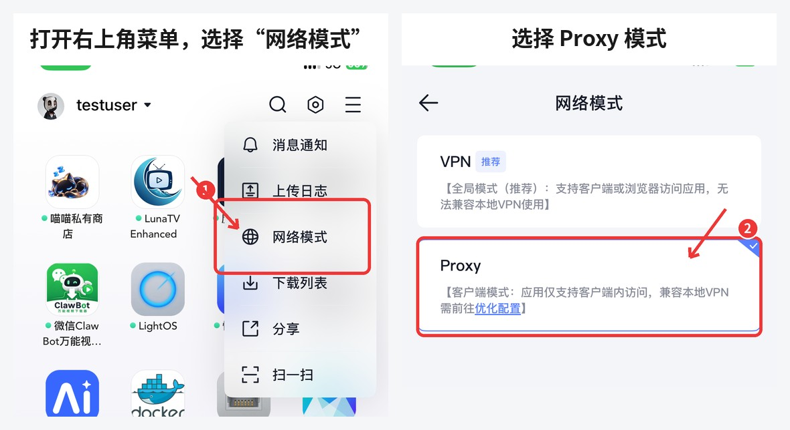
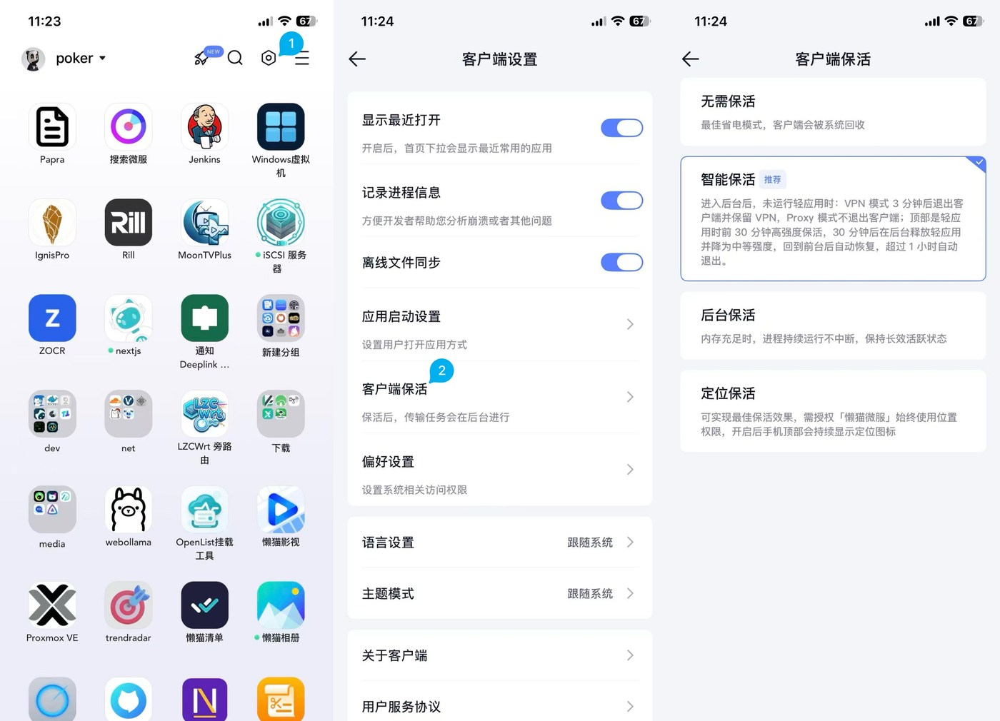
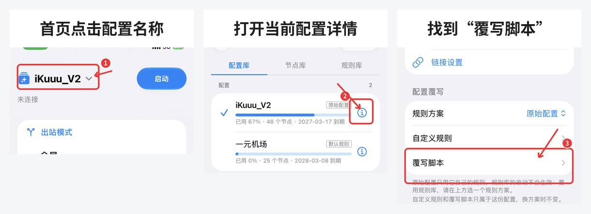
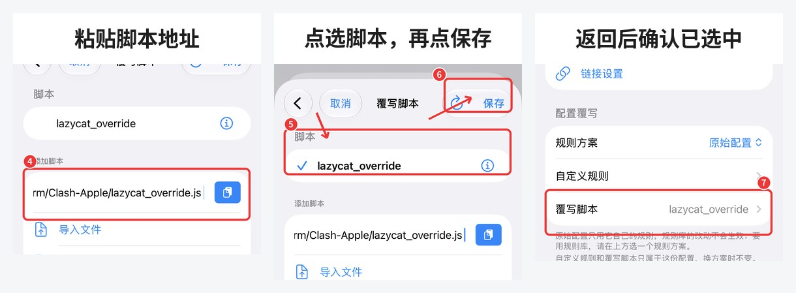
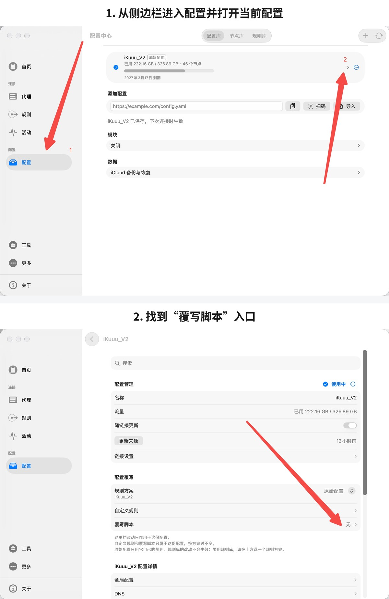
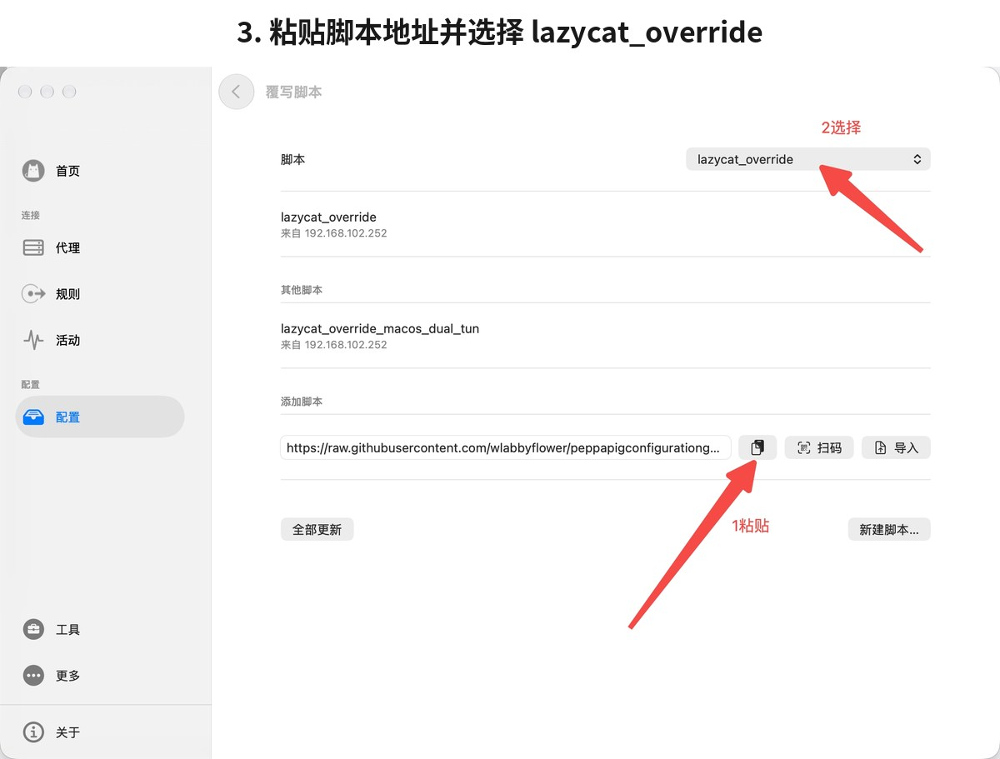
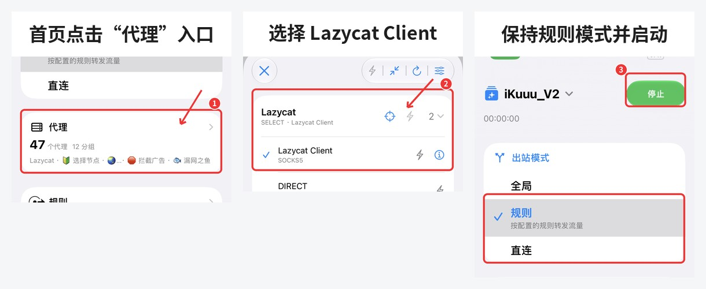
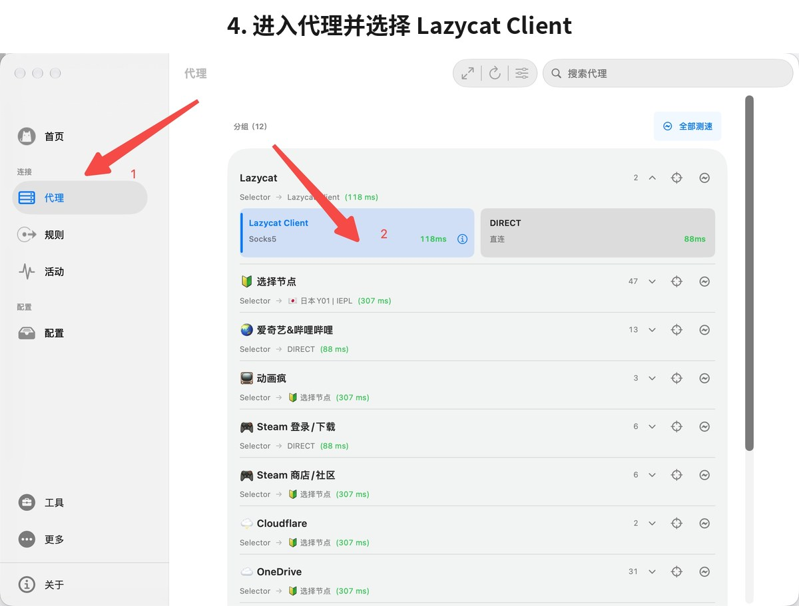
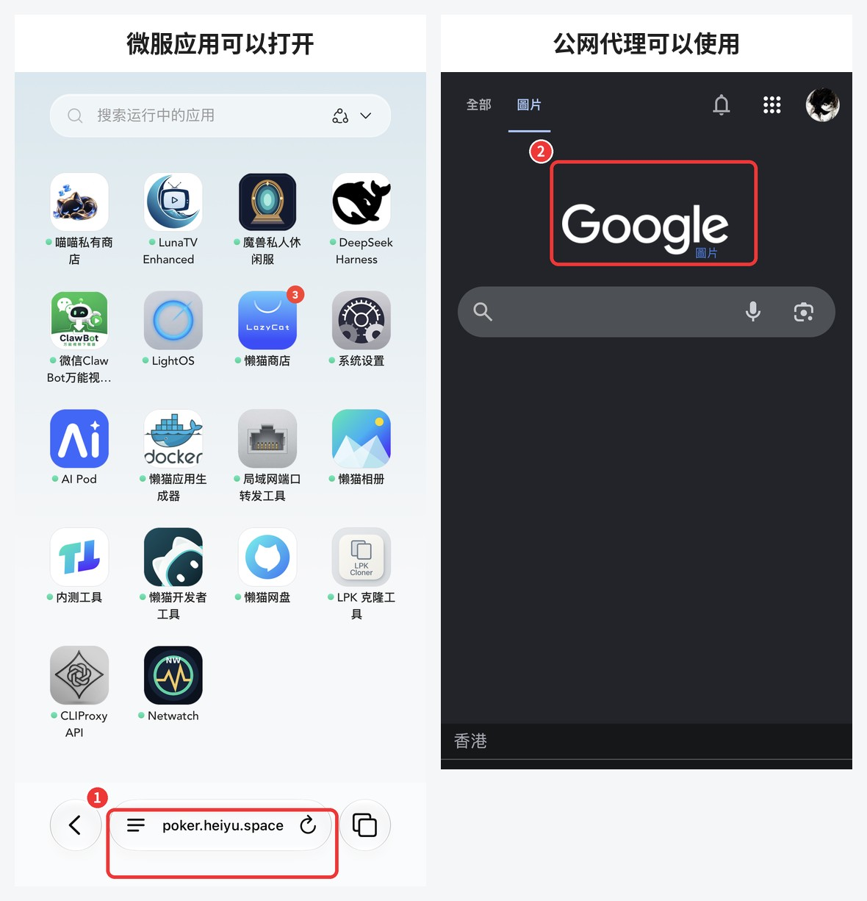

# Clash（clash.md）与懒猫微服共存教程

本教程适用于 [clash.md](https://clash.md/) 发布的 Clash：

- iPhone / iPad
- macOS

开始前，请先确认 Clash 和懒猫微服客户端单独运行时都可以正常使用。

## 一、确认懒猫微服网络模式

### iPhone / iPad

打开懒猫微服客户端，进入网络模式设置，选择 `Proxy`（客户端模式）。切换完成后，请完全退出并重新打开懒猫微服客户端。

<p align="center">
  
</p>

移动端需要保持懒猫微服客户端在后台运行，否则切换到其他应用后可能无法访问微服。

后台保活设置可参考：[懒猫微服官方保活教程](https://developer.lazycat.cloud/network.html#optimize-proxy-mode)

<p align="center">
  
</p>

### macOS

保持懒猫微服客户端的默认网络模式即可，不需要切换到 `Proxy` 模式。

请先确认懒猫微服客户端可以正常连接微服，再继续配置 Clash。

## 二、添加 Clash 覆写脚本

复制下面的脚本地址：

```text
https://raw.githubusercontent.com/wlabbyflower/peppapigconfigurationguide/refs/heads/main/docs/03-%E5%AE%A2%E6%88%B7%E7%AB%AF%E5%85%B1%E5%AD%98/cross-platform/Clash-Apple/lazycat_override.js
```

### iPhone / iPad

1. 打开 Clash。
2. 点击首页左上角当前配置名称。
3. 在配置列表中找到正在使用的配置，点击右侧详情按钮。
4. 找到“配置覆写”中的“覆写脚本 / Override Script”。
5. 粘贴上面的脚本地址，等待出现 `lazycat_override`。
6. 点击选中 `lazycat_override`，再点击右上角“保存”。
7. 返回配置详情，确认“覆写脚本”一栏显示 `lazycat_override`。
8. 更新一次当前配置。
9. 断开并重新连接 Clash。

<p align="center">
  
</p>

<p align="center">
  
</p>

### macOS

1. 打开 Clash。
2. 从左侧进入“配置 / Profiles”。
3. 打开当前正在使用的配置。
4. 找到“配置覆写”中的“覆写脚本 / Override Script”。
5. 粘贴上面的脚本地址，点击“全部更新”，等待出现 `lazycat_override`。
6. 在页面上方的脚本下拉框中选择 `lazycat_override`。
7. 返回配置详情，确认“覆写脚本”一栏显示 `lazycat_override`。
8. 更新一次当前配置。
9. 断开并重新连接 Clash。

<p align="center">
  
</p>

<p align="center">
  
</p>

## 三、选择懒猫节点

重新连接 Clash 后，先回到首页，点击“代理 / Proxies”卡片进入代理页面。

在代理页面找到下面的策略组：

```text
Lazycat
```

进入该策略组并选择：

```text
Lazycat Client
```

<p align="center">
  
</p>

macOS 操作如下：

<p align="center">
  
</p>

Clash 请保持“规则 / Rule”模式。机场节点可以正常切换，不会影响懒猫微服的访问。

## 四、验证是否配置成功

完成配置后，请依次测试：

1. 浏览器可以正常访问公网代理网站。
2. 浏览器可以打开自己的微服域名和微服应用。
3. Clash 的 `Lazycat` 策略组当前选择的是 `Lazycat Client`。
4. 更新机场订阅后，微服仍然可以正常访问。

如果以上项目都正常，说明共存配置已经生效。

<p align="center">
  
</p>

## 常见问题

### 看不到 Lazycat 策略组

请检查：

1. 覆写脚本是否添加在当前正在使用的配置中；
2. 脚本地址是否完整；
3. 保存后是否更新了当前配置；
4. 是否断开并重新连接了 Clash。

### 能访问公网，但打不开微服

请检查：

1. iPhone / iPad 上懒猫微服客户端是否处于 `Proxy` 模式；
2. macOS 上是否保持懒猫微服客户端默认网络模式；
3. 修改移动端网络模式后是否重新启动了懒猫微服客户端；
4. `Lazycat` 策略组是否选择了 `Lazycat Client`；
5. iPhone / iPad 上懒猫微服客户端是否仍在后台运行。

### 更新订阅后不能使用

覆写脚本不会修改机场订阅原文件。请进入当前配置详情，确认“覆写脚本”仍然选择了本教程提供的地址，然后重新更新并连接。

### macOS 仍然提示域名无法解析

请先升级到最新版 Clash，重新更新配置并连接。新版客户端需要包含 macOS 系统解析的兼容兜底。

如果升级后仍有问题，请完全退出 Clash 和懒猫微服客户端，再按以下顺序启动：

1. 启动懒猫微服客户端；
2. 保持 macOS 默认网络模式；
3. 启动 Clash；
4. 更新配置并重新连接。

<details>
<summary><strong>macOS 双 TUN 高级方案（实验性，点击展开）</strong></summary>

此方案仅供熟悉 macOS 网络配置的用户测试。普通用户请使用上面的默认脚本。

### 使用条件

- 仅适用于 macOS；
- 懒猫微服客户端保持 macOS 默认网络模式；
- 启动 Clash 后，懒猫微服 VPN 仍然保持连接；
- 如果两个 VPN 无法同时保持连接，请不要使用此方案；
- 物理网络没有 IPv6 时可能出现解析失败、路由异常或无法访问微服等情况。

### 脚本地址

```text
https://raw.githubusercontent.com/wlabbyflower/peppapigconfigurationguide/refs/heads/main/docs/03-%E5%AE%A2%E6%88%B7%E7%AB%AF%E5%85%B1%E5%AD%98/cross-platform/Clash-Apple/lazycat_override_macos_dual_tun.js
```

### 配置方法

1. 保持懒猫微服客户端的 macOS 默认网络模式；
2. 确认懒猫微服 VPN 已连接；
3. 在 Clash 当前配置的“覆写脚本”中填写上面的双 TUN 脚本地址；
4. 更新当前配置；
5. 重新连接 Clash；
6. 测试公网和微服应用是否都能正常访问。

双 TUN 脚本不会创建 `Lazycat` 策略组，这是正常现象。

如果出现微服打不开、网络中断、两个 VPN 互相断开，或者当前物理网络没有 IPv6 时运行异常，请立即换回默认脚本，懒猫微服继续保持 macOS 默认网络模式。仍无法恢复时，请联系官方技术人员协助处理。

</details>
